# AI Video Editing — Montaj studiyasi

Marketing agentliklari va kontent jamoalari uchun o'zbekcha AI video montaj dashboard'i. Raw video, referenslar va istaklarni yuklaysiz; tizim tahlil, montaj, titr, grafika, ovoz va sifat tekshiruvini bajarib, natijani versiyalari bilan saqlaydi.

**Loyiha:** AP-1077 — agentic team for editing. **Holat:** faol ishlab chiqilmoqda. Windows'da real montajlar bajarilgan; Linux/Docker uchun deploy konfiguratsiyasi mavjud. Serverdagi haqiqiy API/OAuth bilan to'liq montaj va AE bilan to'liq montaj alohida tekshiruvni talab qiladi.

[Skrinshotlar](#interfeysdan-lavhalar) · [Ishga tushirish](#ishga-tushirish) · [Arxitektura](#arxitektura) · [Uslublar](#montaj-uslublari) · [Testlar](#testlar) · [Server qo'llanmasi](DEPLOY.md) · [Handoff](HANDOFF.md)

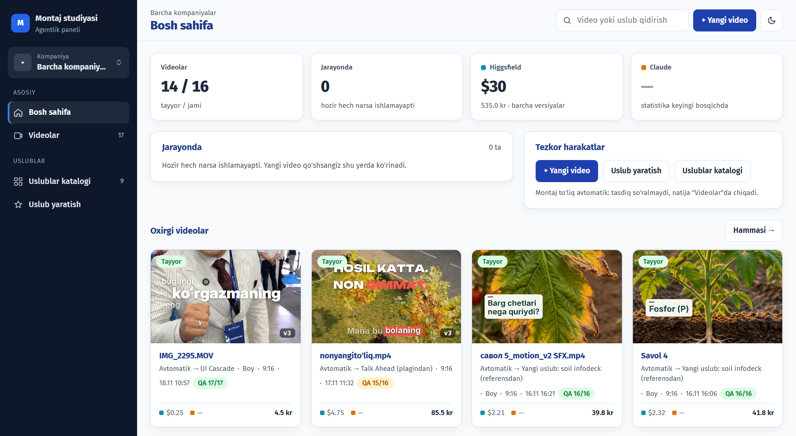

*Bir panelda: ishlar holati, tayyor videolar, versiyalar, sifat natijalari va sarf.*

## Interfeysdan lavhalar

**Material → format va uslub → limit → brief → montaj → tekshiruv → tuzatish.** Quyida har bir bosqichning yaqin ko'rinishi va undagi boshqaruvlar tushuntirilgan.

[Materiallar](#1-materiallarni-topshirish) · [Format](#2-format-va-avtomatik-uslub) · [Byudjet](#3-montaj-byudjeti) · [Brief](#4-istaklar-va-referenslar) · [Katalog](#5-uslublar-katalogi) · [Natija](#6-tayyor-video-va-versiyalar) · [Hisobot](#7-vaqt-belgilari-bilan-montaj-hisoboti) · [QA](#8-sifat-tekshiruvi) · [Feedback](#9-vaqtga-boglangan-tuzatish)

Rasmlar **2026-11-19** kuni lokal interfeysdan olingan. Natija va hisobotlar saqlangan haqiqiy ishga tegishli. `$5` limiti, brief va feedback matnlari ko'rsatma uchun kiritilgan, yuborilmagan. Bosh sahifadagi akkaunt balansi berkitilgan. Rasmlarni bosib, to'liq o'lchamda ochish mumkin.

### 1. Materiallarni topshirish

**“Yangi video”** sahifasida asosiy video va montajga qo'shiladigan materiallar alohida maydonlarga beriladi.

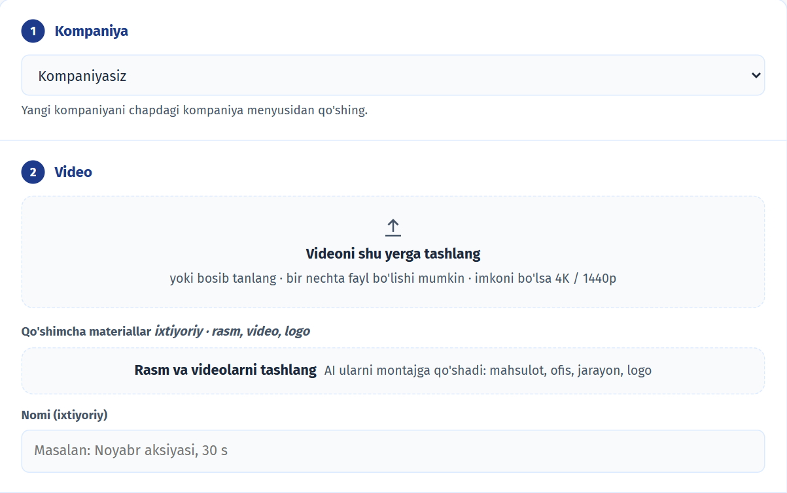

- **Kompaniya:** ishlarni mijoz yoki jamoa bo'yicha guruhlash; “Kompaniyasiz” ham mumkin.
- **Video:** bitta yoki bir nechta raw faylni tashlash yoxud bosib tanlash. Qisqa tomon kamida 720 px bo'lishi kerak.
- **Qo'shimcha materiallar:** logo, mahsulot rasmi, B-roll va boshqa video. Fayl tanlangach, unga izoh va majburiy foydalanish belgisi qo'yish mumkin.
- **Nomi:** ro'yxatda tez topish uchun tushunarli ish nomi.

### 2. Format va avtomatik uslub

Format kartasi chiqadigan videoning nisbatini ham, o'lchamini ham belgilaydi. Rasmda **9:16 — 1080×1920** tanlangan.

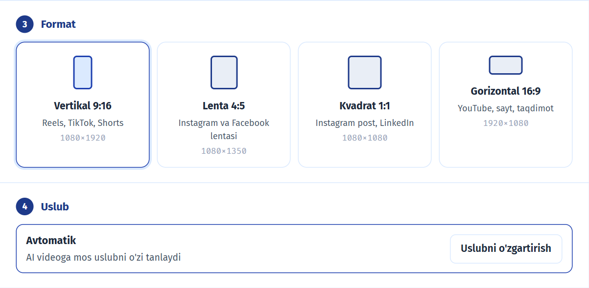

**Avtomatik** tanlovda agent raw video, referens va istaklarga qarab uslub tanlaydi. Aniq vizual yo'nalish kerak bo'lsa, **“Uslubni o'zgartirish”** orqali katalogdagi variantni belgilang. Formatlarning qo'llanishi har bir kartaning o'zida yozilgan.

### 3. Montaj byudjeti

**Minimal**, **Standart** yoki **Boy** darajasi montaj imkoniyatlari va Higgsfield kredit chegarasini birga belgilaydi. Mustaqil dollar limiti ham berish mumkin.

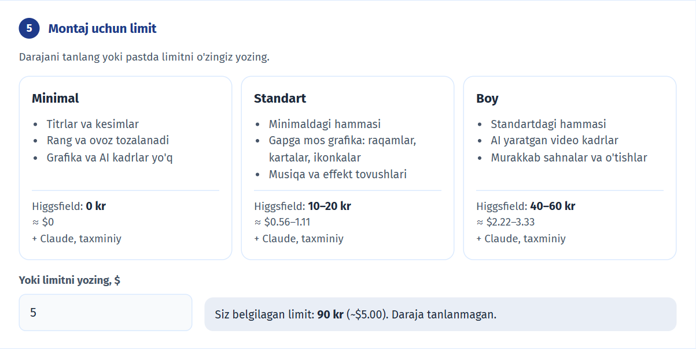

Rasmdagi misol: **`$5 × 18 = 90 kredit`**. Dollar yozilganda daraja tanlovi tozalanadi; “Boy” darajasining 60 kredit chegarasi bu limitni kesmaydi. Pastdagi xabar hisoblangan limitni darhol ko'rsatadi. **Claude xarajati alohida.** Hisoblash qoidalari: [Format va xarajat](#format-va-xarajat).

### 4. Istaklar va referenslar

Brief'da natijaning ko'rinishi va kerakli cheklovlarni yozing: til, rang, titr, o'tishlar, logo va ovoz bo'yicha aniq istaklar.

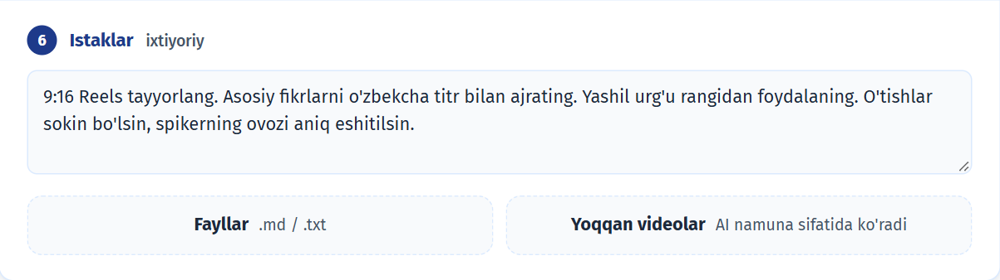

- **Istaklar:** rasmda yashil urg'u rangi, o'zbekcha titr, sokin o'tish va aniq ovoz so'ralgan.
- **Fayllar:** batafsil brief yoki brend ko'rsatmalarini `.md` / `.txt` orqali berish.
- **Yoqqan videolar:** referenslar qo'shish. Referens tanlangach, unda aynan nima yoqqanini yozadigan qo'shimcha maydon ochiladi.

### 5. Uslublar katalogi

Har bir kartada uslubning vizual namunasi, nimaga mosligi, ishlatilgan videolar soni va **“Tanlash”** tugmasi bor. Filtrlar umumiy hamda agentlik uslublarini ajratadi.

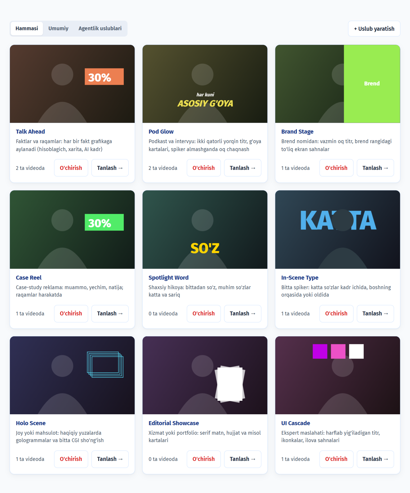

Masalan, **Talk Ahead** fakt va raqamlarga, **Pod Glow** podkastga, **UI Cascade** ekspert maslahati va ilova ko'rinishidagi sahnalarga mos. **“Uslub yaratish”** orqali kamida ikki referens asosida yangi yo'nalish yaratish mumkin. To'liq tavsiflar: [Montaj uslublari](#montaj-uslublari).

### 6. Tayyor video va versiyalar

Quyida haqiqiy **UI Cascade** montajining uchinchi versiyasi. Videodagi titr va “Keling” grafikasi tayyor natijaning o'zidan ko'rinmoqda.

<a href="docs/images/edit-result.png">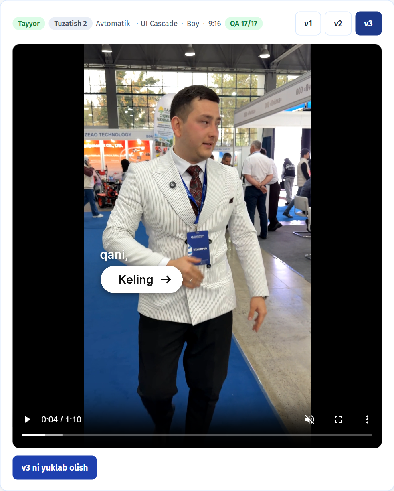</a>

| Boshqaruv | Nima ko'rsatadi yoki bajaradi |
|---|---|
| `Tayyor`, `Tuzatish 2` | Ish holati va bajarilgan tuzatish raqami |
| `UI Cascade · Boy · 9:16` | Shu ishning uslubi, darajasi va formati |
| `QA 17/17` | Joriy natijaning sifat tekshiruvi xulosasi |
| `v1`, `v2`, `v3` | Oldingi yoki joriy videoni ochish; rasmda `v3` tanlangan |
| Video pleyeri | Ko'rish, to'xtatish va kerakli vaqtga o'tish |
| `v3 ni yuklab olish` | Tanlangan versiyani fayl sifatida olish |

### 7. Vaqt belgilari bilan montaj hisoboti

**“Nima qilindi”** paneli montaj qarorlarini videodagi vaqt va aytilgan gap bilan bog'laydi. Har bir qatorni bosish pleyerni tegishli joydan ishga tushiradi.

<a href="docs/images/edit-timeline.png">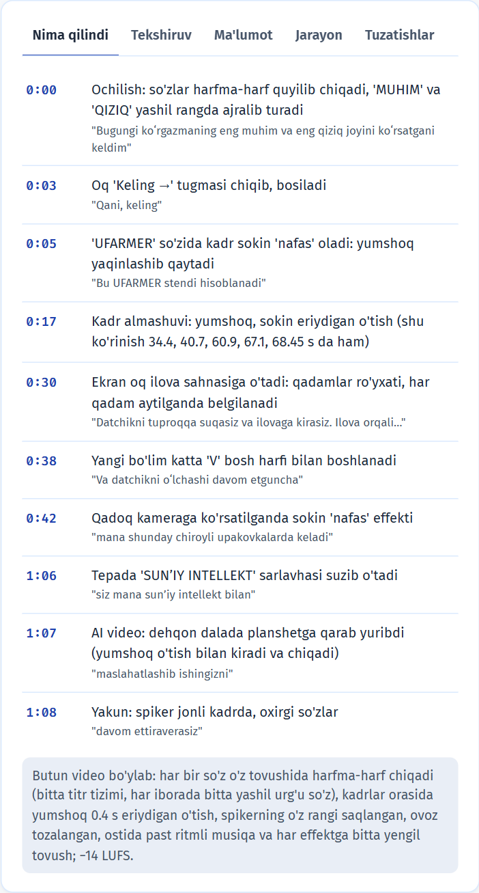</a>

Bu misolda **0:03** da “Keling” tugmasi, **0:30** da qadamli ilova sahnasi, **1:07** da AI video lavha qayd etilgan. Pastdagi umumiy izoh butun video bo'ylab ishlatilgan titr, rang, o'tish, musiqa va ovoz yechimini tushuntiradi.

### 8. Sifat tekshiruvi

**“Tekshiruv”** paneli texnik QA natijasini bandma-band ochadi. Shu ishning joriy versiyasi **17/17** tekshiruvdan o'tgan.

<a href="docs/images/quality-checks.png">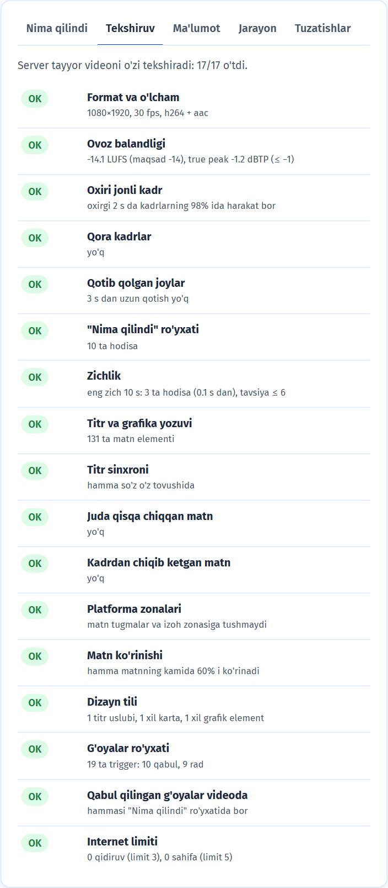</a>

| Tekshiruv guruhi | Rasmdagi dalil |
|---|---|
| Video va audio | 1080×1920, 30 fps, H.264 + AAC; −14.1 LUFS, true peak −1.2 dBTP |
| Kadrlar | Qora kadr yo'q, 3 soniyadan uzun qotish yo'q, yakun jonli |
| Titr | So'zlar tovushga mos; juda qisqa yoki kadrdan chiqib ketgan matn yo'q |
| Joylashuv | Matn platforma tugmalari va izoh zonasiga tushmagan |
| Dizayn va hisobot | Titr/karta/grafika izchilligi, g'oyalar va hisobot mosligi |

### 9. Vaqtga bog'langan tuzatish

Natijani ko'rayotib kerakli kadrda to'xtating. **“Vaqtni qo'shish”** tugmasi o'sha vaqtni feedback maydoniga kiritadi; keyin aynan nima o'zgarishini yozing.

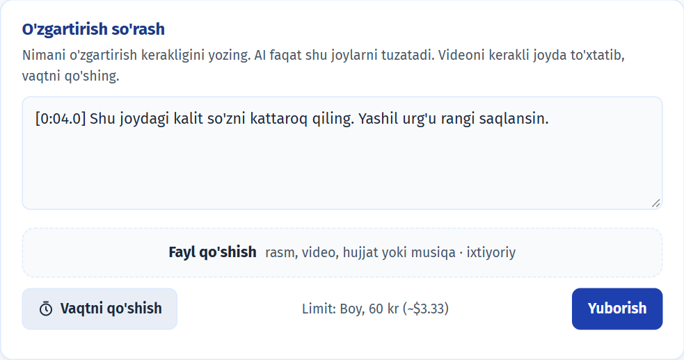

1. Videoda tuzatish kerak bo'lgan joyni toping va vaqt belgisini qo'shing.
2. So'rovni aniq yozing. Rasmda kalit so'zni kattalashtirib, yashil rangni saqlash so'ralgan.
3. Zarur bo'lsa rasm, video, hujjat yoki musiqa biriktiring; pastda tuzatish limiti ko'rinadi.
4. **“Yuborish”** tuzatishni boshlaydi. Oldingi natija versiya sifatida saqlanadi.

*Rasmdagi feedback — yuborilmagan namuna.*

[↑ Qo'llanma boshiga](#interfeysdan-lavhalar) · [Lokal ishga tushirish →](#ishga-tushirish)

## Imkoniyatlar

- **Video topshirish:** bir nechta raw video, referens video, matnli brief, rasm, logo va B-roll; materiallarga izoh va majburiy foydalanish belgisi.
- **Uslub tanlash:** 9 ta tayyor uslub yoki raw video, referens va istaklar asosida avtomatik tanlash.
- **Referens tahlili:** kesimlar, rang, harakat, titr, o'tishlar va ovoz; userning “nimasi yoqdi” izohini hisobga olish.
- **AI montaj:** transkripsiya, odam maskasi, bosh kuzatuvi, titr, kamera harakati, grafika va ovoz miksi.
- **Generatsiya:** Higgsfield orqali rasm, video, audio va upscale; har bir ish uchun kredit hisoboti.
- **QA:** format, ovoz balandligi, qora/muzlagan kadr, titr sinxroni, joylashuv va dizayn izchilligi.
- **Feedback:** vaqtga bog'langan izoh/fayllar orqali tuzatish; eski natijalarni versiya sifatida saqlash.
- **Tiklash:** xato ishni qayta yurgizish; uzilgan agentni bir marta tiklash; 429/overloaded bo'lsa 10 daqiqadan keyin bir urinish.
- **Uslub yaratish:** kamida ikki referensdan yangi skill va renderer; katalogdan uslubni olib tashlash.
- **Boshqaruv:** kompaniya bo'yicha guruhlash, arxivlash, natijalarni yuklab olish va retention.
- **After Effects:** Windows'da alohida motion grafika elementlarini AE orqali yaratish va alpha bilan montajga qo'shish.

Mahsulot gapirayotgan odam qatnashgan videolarga yo'naltirilgan. Spikersiz reklama, faqat B-roll yoki faqat voiceover uchun universal montaj tizimi hali emas.

## Ish jarayoni

1. Raw videolar va kerakli materiallarni yuklang.
2. Format, uslub yoki avtomatik tanlov, montaj darajasi yoxud dollar limitini belgilang.
3. Referenslarni va aynan nima kerakligini yozing. Userning joriy ko'rsatmalari referens va plagin qoidalaridan ustun.
4. Ishni yuboring. Dashboard navbat, agent faoliyati va bosqichlarni ko'rsatadi.
5. Natija, QA, xarajat va “Nima qilindi” ro'yxatini ko'ring.
6. Kerak bo'lsa, video vaqtini ko'rsatib feedback yuboring. Oldingi versiya saqlanadi.

## Arxitektura

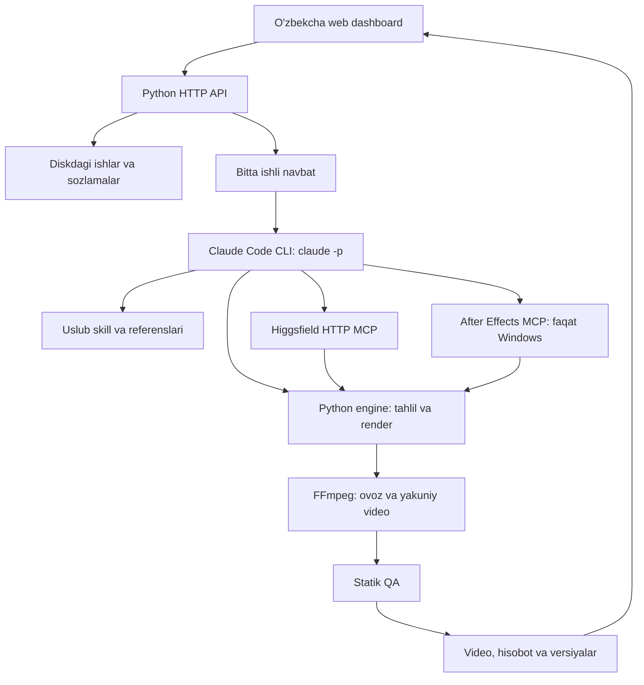

Agent **Claude Code CLI** orqali ishlaydi; bu to'g'ridan-to'g'ri Anthropic SDK integratsiyasi emas. Nomidagi “team” bir nechta bosqich va vositalarning birgalikdagi ishini anglatadi: joriy runner RAM sabab **bitta ishni** bajaradi, parallel subagentlar o'chirilgan.

Frontend oddiy HTML/CSS/JavaScript. Node frontend build, alohida database yoki Redis kerak emas. Holat va hisobotlar diskdagi JSON/fayllarda saqlanadi. Linux'da Caddy HTTPS beradi.

| Qatlam | Texnologiya |
|---|---|
| Dashboard/API | Python standart kutubxonasi, `ThreadingHTTPServer` |
| Frontend | HTML, CSS, vanilla JavaScript |
| Agent | Claude Code CLI, style plugin, task shablonlari |
| Generatsiya | Higgsfield HTTP MCP va alohida OAuth |
| Video/audio | FFmpeg, ffprobe, NumPy, OpenCV, Pillow |
| Transkripsiya | faster-whisper, Whisper large-v3, CTranslate2 |
| Odam maskasi | ONNX Runtime, RVM MobileNetV3 |
| Motion grafika | After Effects 2025, ExtendScript, lokal MCP |
| Deploy | Docker Compose, Caddy, persistent volume'lar |

## Montaj uslublari

| Uslub | Asosiy foydalanish |
|---|---|
| [`talk_ahead`](styles/docs/talk_ahead.md) | Fakt/raqamli explainer, matn, hisoblagich va insertlar |
| [`pod_glow`](styles/docs/pod_glow.md) | Podkast/intervyu, ikki qatorli titr va aksentli kartalar |
| [`brand_stage`](styles/docs/brand_stage.md) | Brend nomidan gapiradigan spiker, brend sahnalari va B-roll |
| [`case_reel`](styles/docs/case_reel.md) | Muammo → yechim → natija tartibidagi case study |
| [`spotlight_word`](styles/docs/spotlight_word.md) | Bittadan so'z va katta aksentli kalit so'zlar |
| [`in_scene_type`](styles/docs/in_scene_type.md) | Kadr ichidagi qatlamli matn va spikerga bog'langan tipografika |
| [`holo_scene`](styles/docs/holo_scene.md) | Haqiqiy muhitga joylashtirilgan golografik grafika |
| [`editorial_showcase`](styles/docs/editorial_showcase.md) | Ish/portfolio namoyishi, serif tipografika va demo panellar |
| [`ui_cascade`](styles/docs/ui_cascade.md) | Stack titr, shisha kartalar va ilova ko'rinishidagi sahnalar |

Uslub qoidalari `styles/skills/<name>/SKILL.md` va `references/` ichida. Barcha 9 uslub uchun umumiy renderer tayyor deb hisoblamang: built-in renderer `in_scene_type` uchun bor; qolganlarida job ichidagi compositor ishlatilishi mumkin. Yangi uslub `renderer.py`, `renderer_example.json` va reference hujjatlari bilan tekshiruvdan o'tishi kerak. Tafsilot: [styles/README.md](styles/README.md).

## Format va xarajat

Natija: **30 fps, H.264 video + AAC audio**, odatda **−14 LUFS**, true peak **≤ −1 dBTP**.

| Format | O'lcham | Qo'llanish |
|---|---|---|
| 9:16 | 1080 × 1920 | Reels, TikTok, Shorts |
| 4:5 | 1080 × 1350 | Instagram/Facebook lenta |
| 1:1 | 1080 × 1080 | Kvadrat post |
| 16:9 | 1920 × 1080 | YouTube, sayt va taqdimot |

Raw videoning qisqa tomoni kamida 720 px bo'lishi kerak.

| Daraja | Higgsfield krediti | Maqsad |
|---|---|---|
| Minimal | 0 | Titr, o'tish, rang va ovoz; AI generatsiya va qo'shimcha grafikasiz |
| Standart | 10–20 | Uslub elementlari va AI rasmlar |
| Boy | 40–60 | Standart imkoniyatlari va AI video lavhalar |

Daraja o'rniga mustaqil dollar limitini berish mumkin. Joriy hisob: `floor(USD × 18)` kredit; masalan, `$5 → 90 kredit`. Bu taxminiy kurs, **Claude xarajati unga kirmaydi**. Eski API'da daraja va dollar birga berilsa, kichik limit olinadi.

Kredit limitini agent kuzatadi; server billing darajasida majburlamaydi. Dashboard balansi oxirgi hisobotdan olinadi va akkauntdagi boshqa sessiyalar sarfi ta'sir qilishi mumkin. `DASH_DRY_RUN=1` real agent/generatsiya ishlatmaydi va token/kredit sarflamaydi.

## Ishga tushirish

### Talablar

- **Python 3.12**, **Node.js 22+**, Git, FFmpeg va ffprobe.
- To'liq montaj uchun [deploy/requirements.txt](deploy/requirements.txt) paketlari va Claude Code CLI.
- Tavsiya: **16 GB RAM**, **100 GB SSD**, 4–8 CPU yadrosi. GPU shart emas.
- Claude uchun lokal subscription login yoki API kaliti; Higgsfield uchun alohida akkaunt/OAuth.
- RVM modeli `models/rvm_mobilenetv3_fp32.onnx` ichida. Whisper large-v3 birinchi ASR'da yuklanadi; internet va qo'shimcha disk joyi kerak.

### Windows: lokal montaj

PowerShell'da:

```powershell
git clone https://github.com/NegmurodovBexruz/AI-video-editing-.git
Set-Location AI-video-editing-
python -m venv .venv
.\.venv\Scripts\python.exe -m pip install -r deploy\requirements.txt
npm install -g @anthropic-ai/claude-code@2.1.322
ffmpeg -version
ffprobe -version

$env:DASH_AGENT_PYTHON = (Resolve-Path .\.venv\Scripts\python.exe).Path
$env:DASH_ASR_PYTHON = $env:DASH_AGENT_PYTHON
$env:ENGINE_ASR_PYTHON = $env:DASH_AGENT_PYTHON

claude auth login --claudeai
claude mcp add --transport http --scope user higgsfield https://mcp.higgsfield.ai/mcp
claude mcp login higgsfield
claude mcp get higgsfield
.\dashboard\start.cmd
```

Dashboard: **http://127.0.0.1:8050**. Environment qiymatlari shu terminal va uning child jarayonlariga tegishli; yangi terminalda qayta belgilang. Koddagi eski PC yo'llari boshqa kompyuterda mos kelmasligi sabab Python yo'llarini aniq ko'rsatish kerak.

`higgsfield` MCP avval ro'yxatdan o'tgan bo'lsa, `mcp add` qadamini takrorlamang; `mcp get higgsfield` bilan endpoint va ulanishni tekshiring.

`start.cmd` lokal subscription rejimini tanlaydi va meros API/gateway muhitini faqat o'z jarayonida tozalaydi. API rejimida lokal ishlash uchun credential'larni terminal muhitida sozlab, `DASH_CLAUDE_AUTH=api` bilan `python -I dashboard/server.py --no-browser`dan foydalaning. Lokal Python server `.env`ni o'zi yuklamaydi; Compose esa yuklaydi.

Lokal login odatda o'chiq; mavjud `projects/auth/users.json` topilsa launcher uni yoqadi. Tarmoq/server uchun login va HTTPS'ni sozlang.

### Linux server: Docker Compose

```bash
git clone https://github.com/NegmurodovBexruz/AI-video-editing-.git
cd AI-video-editing-
cp .env.example .env
# .env: DOMAIN, yangi DASH_ADMIN_PASSWORD, ANTHROPIC_API_KEY ni sozlang.
docker compose config --quiet
docker compose up -d --build
docker compose exec -it dashboard claude mcp login higgsfield --no-browser
docker compose exec dashboard python -I /app/deploy/check_connections.py
```

Domenning A yozuvi serverga qarashi, 80/443 portlar ochiq bo'lishi kerak. Dashboard `https://DOMAIN`da ochiladi. Docker Claude API rejimidan foydalanadi; PC subscription loginini avtomatik olmaydi. Higgsfield OAuth va Claude API alohida ulanishlar.

`check_connections.py` konfiguratsiya va MCP ulanishini tekshiradi; model chaqirmaydi va API kalitining haqiqiy ishlashini to'liq isbotlamaydi. Deploy, backup, update va izolatsiyalangan dry-run: [DEPLOY.md](DEPLOY.md).

### Bepul dry-run

Agent va generatsiyasiz UI/API oqimini tekshirish uchun, repo ildizidan PowerShell'da:

```powershell
$env:DASH_DRY_RUN = "1"
$env:DASH_AUTH = "0"
$env:DASH_PORT = "8051"
$env:DASH_RETENTION_DAYS = "0"
python -I -B dashboard\server.py --no-browser
```

Ochish: **http://127.0.0.1:8051**. FFmpeg/ffprobe PATH'da bo'lsin: yuklangan videoni tekshirishda kerak. Soxta agent `dashboard/dev/fake_agent.py`; natijalar alohida `projects/jobs_dryrun/`da saqlanadi. Real rejim uchun yangi terminal oching yoki dry-run environment qiymatlarini olib tashlang. Bu sinov montajning vizual sifatini baholamaydi.

## After Effects rejimi

AE integratsiyasi **Windows + After Effects 2025** uchun. O'rnatilgan AE `Support Files` papkasini belgilang:

```powershell
$env:AE_DIR = "C:\Program Files\Adobe\Adobe After Effects 2025\Support Files"
# Kerak bo'lmasa:
$env:DASH_AE = "0"
```

AE topilsa va `DASH_AE=0` bo'lmasa, runner `ae_run`, `ae_frames`, `ae_render` MCP vositalarini beradi. Agent grafik elementlarni alohida comp qilib, PNG preview'da tekshiradi, alpha ProRes 4444 bilan chiqarib, asosiy montajga qo'shadi.

Bir vaqtda bitta AE jarayoni, kamida 3 GB bo'sh RAM va job yo'li chegarasi tekshiriladi. Ochiq user AE loyihasi bor bo'lsa, chaqiruv rad etiladi. Linux/Docker'da AE yo'q. Tafsilot: [ae_mcp/README.md](ae_mcp/README.md).

## Sozlamalar

| O'zgaruvchi | Vazifasi |
|---|---|
| `DASH_HOST`, `DASH_PORT` | Bind manzili/port; lokal `127.0.0.1:8050` |
| `DASH_DATA` | Data root; lokal `projects/`, Docker `/data` |
| `DASH_STYLES`, `DASH_STYLE_NOTES` | Uslub katalogi va custom uslub izohlari |
| `DASH_AGENT_PYTHON` | Render/QA paketlari o'rnatilgan Python |
| `DASH_ASR_PYTHON`, `ENGINE_ASR_PYTHON` | Whisper Python'i; engine'da ikkinchisi ustun |
| `DASH_CLAUDE_AUTH` | `auto` — lokal auth; `api` — API credential'lari |
| `ANTHROPIC_API_KEY` | Claude API kaliti |
| `ANTHROPIC_BASE_URL`, `ANTHROPIC_AUTH_TOKEN` | API gateway uchun birgalikda beriladi |
| `DASH_DRY_RUN` | `1` — soxta agent, alohida test ishlari |
| `DASH_AUTH` | `1` — dashboard loginini yoqish |
| `DASH_ADMIN_USER`, `DASH_ADMIN_PASSWORD` | Birinchi ishga tushishda admin yaratish |
| `DOMAIN`, `COOKIE_SECURE` | Compose/Caddy domeni va HTTPS cookie rejimi |
| `DASH_ALLOWED_HOSTS`, `DASH_COOKIE_SECURE` | Python serverdagi host/cookie sozlamalari |
| `DASH_RETENTION_DAYS` | Media muddati; lokal `0`, Docker `14` kun |
| `DASH_AE`, `AE_DIR` | AE rejimi va uning o'rnatilgan papkasi |
| `MEM_LIMIT` | Compose xotira chegarasi, standart `12g` |

Namuna: [.env.example](.env.example). Haqiqiy kalit/parollar `.env` yoki jarayon muhitida saqlanadi.

## Papka tuzilmasi

```text
dashboard/            API, auth, store, runner, task shablonlari
  static/             HTML/CSS/JS interfeys
  dev/                Fake agent va tekshiruvlar
engine/               Tahlil, render, ovoz, QA va reference tahlili
  core/               ASR, matte, media, geometriya va style loader
  fonts/              Render shriftlari
styles/               Claude Code plagini, 9 uslub va reference qoidalari
ae_mcp/               Windows After Effects MCP serveri va JSX yordamchilari
deploy/               Docker entrypoint, Caddy, ulanish/paketlash skriptlari
docs/images/          README uchun lokal interfeys skrinshotlari
assets/               Eski compositorlar uchun shriftlar
models/               RVM ONNX modeli
refs/                 Style yaratish uchun matnli reference namunasi
scripts/              Eski compositor yordamchilari
projects/             Lokal runtime ma'lumotlari; Git'ga kirmaydi
README.md             Loyiha va ishga tushirish
DEPLOY.md             Server, backup va dry-run qo'llanmasi
HANDOFF.md            Qarorlar, tarix va davom ettirish konteksti
```

`scripts/`dagi ayrim yordamchilar tarixiy media va absolyut yo'llarga bog'langan; ular yangi clone'da standalone demo emas. `engine/README.md`da tilga olingan tarixiy test videolari GitHub'ga kiritilmaydi.

Odatdagi ish papkasi:

```text
projects/jobs/<id>/
  job.json            Sozlamalar, holat va limit
  input/              Raw, referenslar va materiallar
  AGENT_TASK.md       Shu ish uchun tayyorlangan topshiriq
  plan.md             Montaj rejasi
  scripts/            Shu ishga xos compositor/kod
  work/               Tahlil, timeline va QA yozuvlari
  gen/                Generatsiya assetlari va xarajat ledger'i
  ae/                 Ixtiyoriy AE loyiha va renderlari
  out/final.mp4       Yakuniy video
  result.json         Dashboard uchun natija hisoboti
  README.md           User uchun bajarilgan ishlar hisoboti
  feedback/           Izohlar va biriktirilgan fayllar
  versions/           Oldingi natijalar
```

`projects/`, asl media, lokal hisoblar, OAuth sessiyalari, cache va release ZIP'lari repository tarkibiga kirmaydi. Docker'da `data`, `claude_home`, `caddy_data`, `caddy_config` volume'lari saqlanishi kerak. `docker compose down -v` ularni o'chiradi. Yangilashdan oldin navbat/ishlar bo'shligini tekshirib, backup oling.

## Testlar

Quyidagi izolyatsiyalangan testlar real API, Higgsfield generatsiya yoki AE renderini boshlamaydi:

```powershell
python -I -B dashboard/dev/connections_check.py
python -I -B dashboard/dev/style_delete_check.py
python -I -B dashboard/dev/retry_check.py
python -I -B dashboard/dev/autoretry_check.py
python -I -B dashboard/dev/restraint_check.py
python -I -B dashboard/dev/ae_mcp_check.py
```

Ishlayotgan **dry-run** server va `raw test.mp4`, `low.mp4`, `notes.md` bor test papkasi bilan:

```powershell
python -I -B dashboard/dev/api_check.py http://127.0.0.1:8051 C:\temp\ap1077-media
python -I -B dashboard/dev/feedback_check.py http://127.0.0.1:8051 C:\temp\ap1077-media
python -I -B dashboard/dev/style_check.py http://127.0.0.1:8051 C:\temp\ap1077-media
```

Sun'iy test media yaratish va Docker ichida sinash buyruqlari [DEPLOY.md](DEPLOY.md#bepul-dry-run-tekshiruvi)da. Bu testlarni production serverga yo'naltirmang.

## Source paket yaratish

```powershell
python -I -B deploy/package_release.py
```

`release/AP-1077-montaj-server-YYYYMMDD.zip` yaratiladi. ZIP'dagi `PACKAGE_MANIFEST.json` fayllar va SHA-256 xeshlarini beradi. Paket **joriy diskdagi koddan** tuziladi; commit qilinmagan o'zgarishlarni ham oladi. README skrinshotlari ham kiradi. Credential'lar, lokal ish papkalari va asl video/audio fayllar kiritilmaydi. Mavjud shu kundagi ZIP ustiga yozilmaydi.

## Ma'lum cheklovlar va keyingi ishlar

- **Bitta worker:** parallel montaj/subagentlar RAM sabab o'chirilgan.
- **Billing:** limit agent nazoratida; qayta urinishda sarfni server darajasida qat'iy hisoblash hali yo'q.
- **Tiklash:** bir martalik avtomatik retry bor; umumiy job timeout va murakkab retry siyosati yo'q. AE chaqiruvlarining o'z timeout'lari bor.
- **User boshqaruvi:** bir admin ishlatishiga mos; multi-user boshqaruv UI'si yo'q.
- **Sifat:** texnik QA ijodiy sifatni to'liq kafolatlamaydi. Agent kontakt varaqni ham ko'rib tekshiradi; effektlar soni emas, dizayn izchilligi talab qilinadi.
- **Rendererlar:** barcha uslubda tayyor engine renderer mavjud emas.
- **Feedback'dan o'rganish:** izoh o'sha ishni tuzatadi; keyingi ishlarga tasdiqlangan qoidalarni olib o'tuvchi “Saboqlar” qatlami hali taklif bosqichida.
- **Muhit:** server/API bilan to'liq montaj va AE bilan to'liq real montaj ushbu snapshot'da tasdiqlangan deb ko'rsatilmaydi. AE vositalarining alohida smoke sinovlari o'tgan.

Joriy qarorlar va dalillar: [HANDOFF.md](HANDOFF.md). Eski misollar bilan zid bo'lsa, joriy kod va handoff'ning so'nggi bo'limlariga qarang.

## Litsenziya

Repository'ning original kodi [MIT License](LICENSE) ostida. Birga kelgan shriftlar OFL 1.1, RVM modeli esa upstream GPL v3 litsenziyasini saqlaydi. Manbalar va litsenziya matnlari: [third_party/README.md](third_party/README.md). Tashqi servislar o'z shartlariga ega.
